# TP Jenkins CI/CD – [Ferid SAAD]

## 1. Environnement
VM Ubuntu 26.04, Docker, K3s, Jenkins, Maven
 ### capture

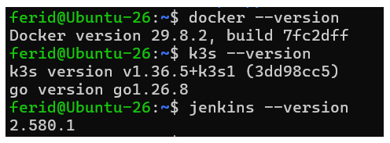
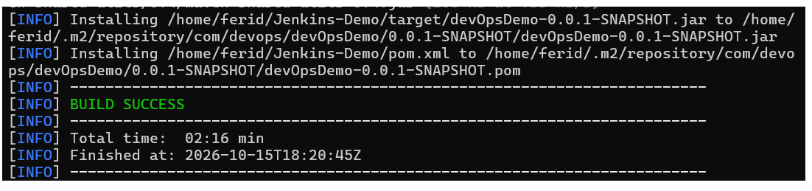

## 2. Workflow manuel- without using Jenkins

### 2.1 Dockerfile
````
# java jdk 17
FROM eclipse-temurin:17-jre
# Set port number
EXPOSE 2222
# Set the working directory in the container
WORKDIR /app
# Copy the packaged JAR file into the container
COPY target/yourApp.jar app.jar
# Specify the command to run on container startup
CMD ["java", "-jar", "app.jar"]
````
### 2.2 Build de l'image
Commandes
````
mvn clean install

docker build -t jenkins-demo:1.0

docker images | grep jenkins-demo
````
#### Capture

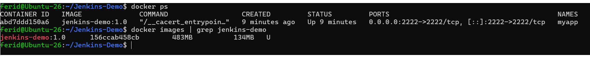


### 2.3 Push sur Docker Hub

1. Login to the docker hub using the below command:
````
docker login -u feridsaad
````

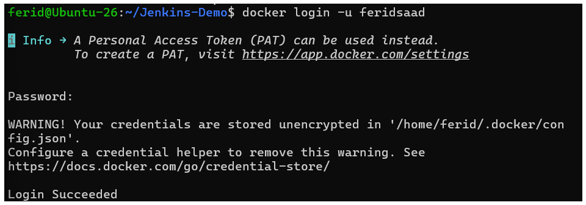

2. Now you tag your image:
````
 docker tag jenkins-demo:1.0 feridsaad/jenkins-demo:1.0
````
3. Push the image to the docker hub:
````

docker push feridsaad/jenkins-demo:1.0
````

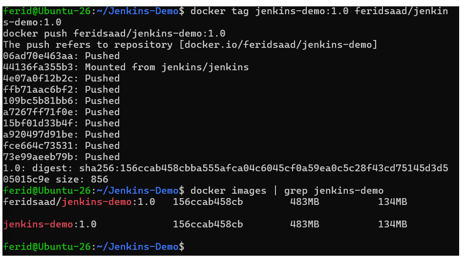

4. Create a container from the image:
````
docker run --detach --name myapp --publish 2222:2222 feridsaad/jenkins-demo:1.0
````
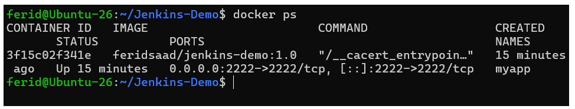

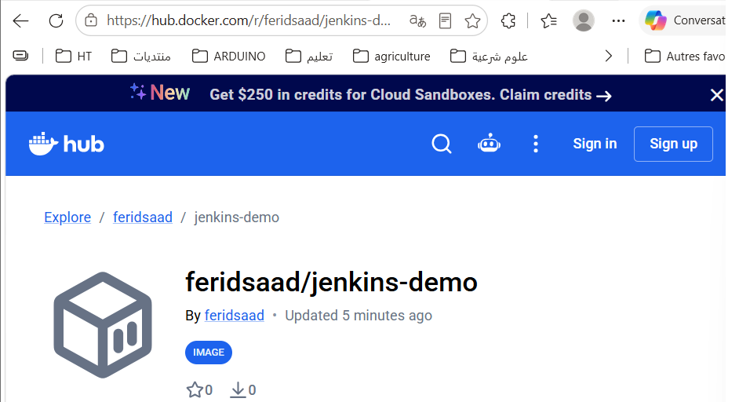


### 2.4 Déploiement Kubernetes
Fichier k8s.yaml
````
apiVersion: v1
kind: Service
metadata:
  name: spring-app-service
spec:
  selector:
    app: spring-app
  ports:
    - protocol: TCP
      port: 8888
      targetPort: 2222
      nodePort: 30222
  type: NodePort
  ````
  Fichier service.yaml

  ````
  apiVersion: v1
kind: Service
metadata:
  name: spring-app-service
spec:
  selector:
    app: spring-app
  ports:
    - protocol: TCP
      port: 8888
      targetPort: 2222
      nodePort: 30222
  type: NodePort
  ````
Exécution
````
kubectl apply -f deployment.yaml
kubectl get pods
````
capture
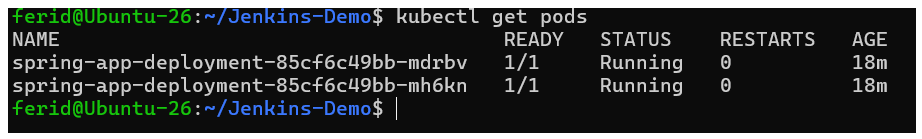
````
kubectl apply -f service.yaml
kubectl get svc
````
capture

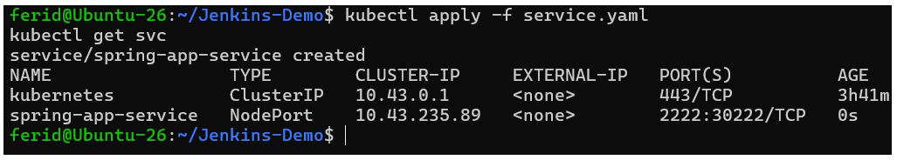

Test d'application
````
curl http://localhost:30222
````
capture

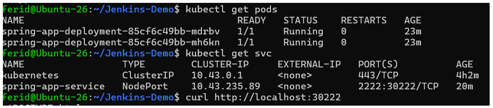
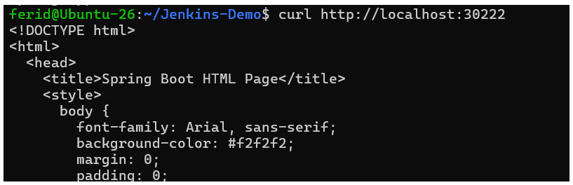
## 3. Jenkins Freestyle
### Étape 1
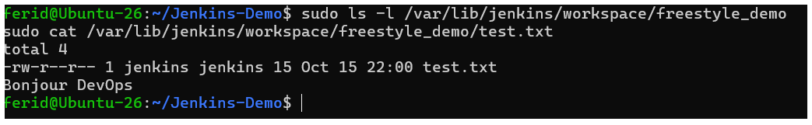

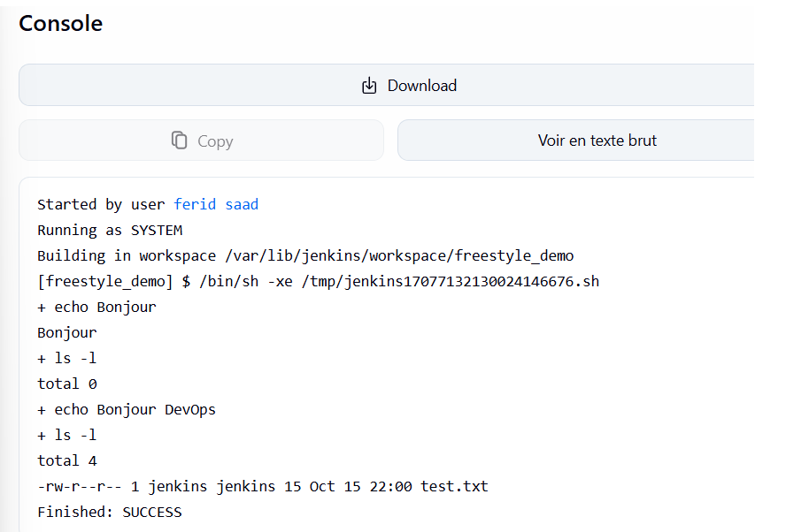

### Etape 2: Test.java

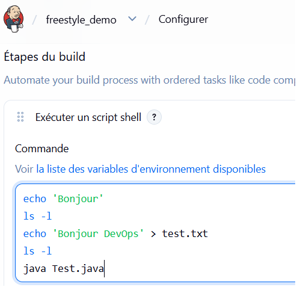

Console
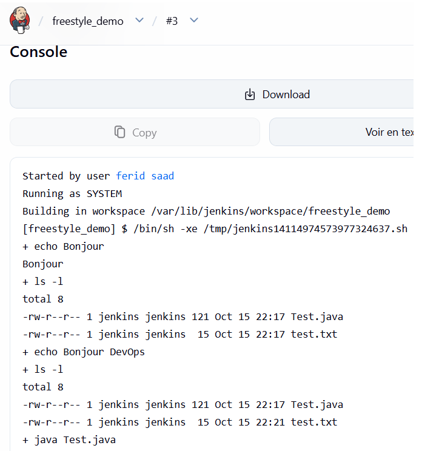

### Étape 3 : récupérer le script depuis GitHub


### Étape 4 : déclenchement automatique et nettoyage
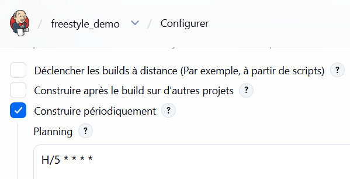

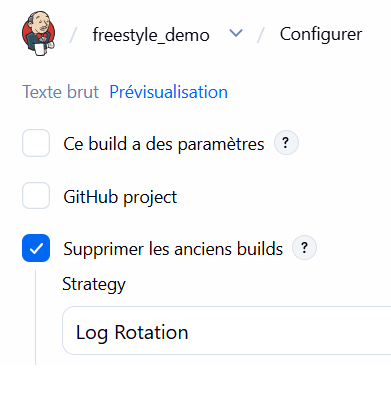

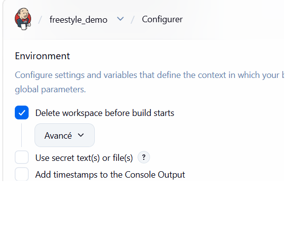

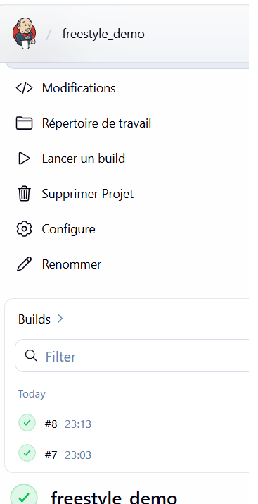


### Étape 5 : le challenge (un job Freestyle qui fait tout)

#### 5.1. Donner à jenkins l’accès à Docker et à K3s
````
sudo usermod -aG docker jenkins
sudo mkdir -p /var/lib/jenkins/.kube
sudo cp /etc/rancher/k3s/k3s.yaml /var/lib/jenkins/.kube/config
sudo chown -R jenkins:jenkins /var/lib/jenkins/.kube
sudo systemctl restart jenkins
````
#### 5.2 

script
````
set -e
IMAGE=feridsaad/jenkins-demo
TAG=$BUILD_NUMBER

# 1. Build Maven
mvn clean install -DskipTests

# 2. Dockerfile (celui du dépôt utilise une image dépréciée)
cat > Dockerfile << 'EOF'
FROM eclipse-temurin:17-jre
EXPOSE 2222
WORKDIR /app
COPY target/devOpsDemo-0.0.1-SNAPSHOT.jar app.jar
CMD ["java", "-jar", "app.jar"]
EOF

# 3. Build et push de l'image
docker build -t $IMAGE:$TAG .
echo "$DOCKER_PASS" | docker login -u "$DOCKER_USER" --password-stdin
docker push $IMAGE:$TAG

# 4. Déploiement sur K3s avec la nouvelle image
sed "s|image: .*|image: $IMAGE:$TAG|" k8s.yml | kubectl apply -f -
kubectl rollout status deployment/spring-app-deployment --timeout=120s

# 5. Vérification
kubectl get pods
kubectl get svc
NODEPORT=$(kubectl get svc spring-app-service -o jsonpath='{.spec.ports[0].nodePort}')
curl -s http://localhost:$NODEPORT | head -5
````
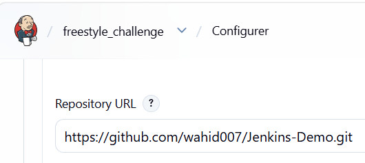

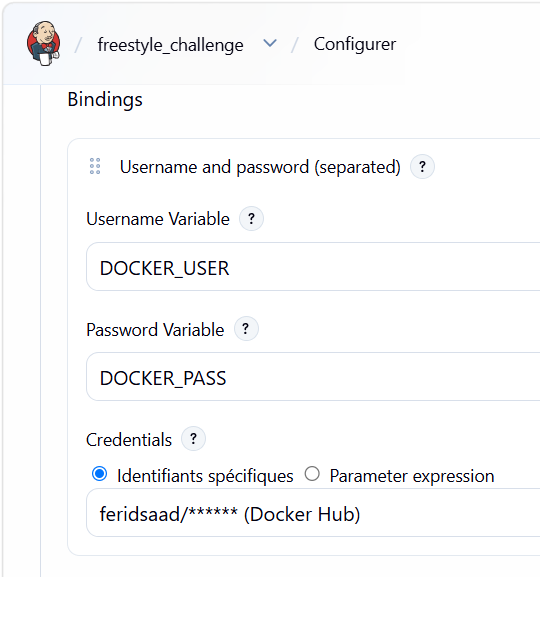

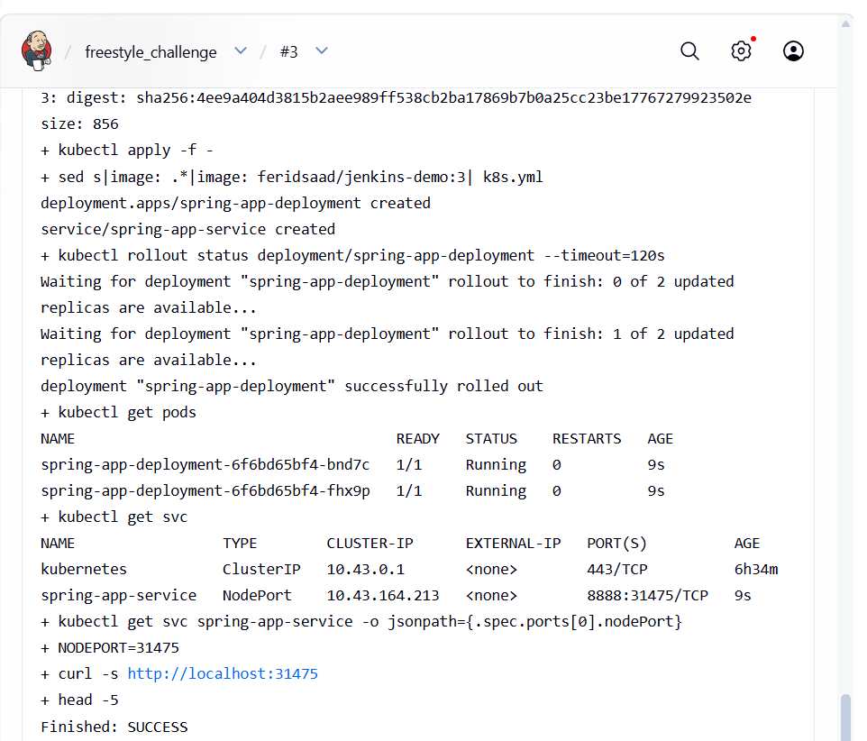

Test-Final

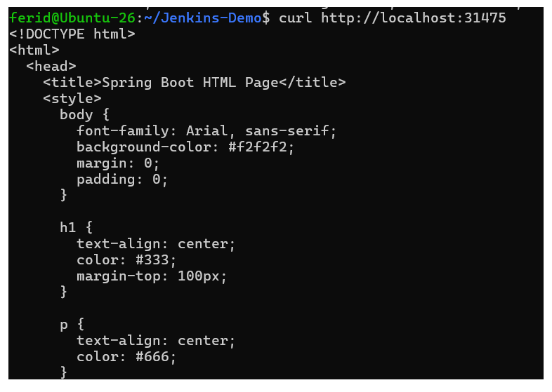

## 4. Difficultés rencontrées et solutions
1. port 2222 dans le sujet contre 8080 dans les YAML,
2. Test.java effacé du workspace au clonage Git, donc ajouté au dépôt,
3. identifiant saisi sous la forme ${ dockerhub}, corrigé en le sélectionnant dans la liste,
4. identifiant Docker Hub sans mot de passe (password is empty), corrigé avec un token,
5. kubectl refusé pour l’utilisateur jenkins, corrigé avec KUBECONFIG.

## 5. Conclusion